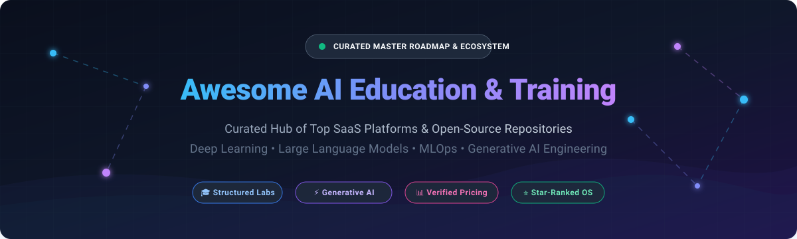

# 🧠 Awesome AI Education & Training

  <strong>Curated Hub of Leading SaaS Learning Platforms & Top-Starred Open-Source Curricula</strong> 
  <em>Master Machine Learning, Deep Learning, Large Language Models (LLMs), MLOps, and Generative AI</em>

  
  
  
  
  
  
  

---

## 📌 Table of Contents

- [🌐 Sector Overview & Market Dynamics](#-sector-overview--market-dynamics)
- [💻 SaaS & Hosted AI Learning Platforms](#-saas--hosted-ai-learning-platforms)
- [🔓 Open-Source GitHub Projects](#-open-source-github-projects)
- [🎯 Core Curriculum Recommendations](#-core-curriculum-recommendations)
- [⭐ Star History](#-star-history)
- [💖 Support & Sponsorship](#-support--sponsorship)
- [🤝 How to Contribute](#-how-to-contribute)
- [📄 Disclaimer](#-disclaimer)

---

## 📖 Overview

This repository tracks notable **SaaS platforms** and **open-source projects** for **AI Education & Training**. These resources provide structured curricula, guided projects, and hands-on labs that take learners from foundational math and coding to production-ready AI engineering, MLOps, and frontier model fine-tuning—without requiring a PhD or expensive bootcamp.

Whether you are looking for enterprise AI workforce upskilling, accredited university specializations, interactive coding sandboxes, or self-paced open-source code repositories, this guide provides an objective, transparent, and comprehensive breakdown.

---

## 🌐 Sector Overview & Market Dynamics

The global AI education and corporate training market is estimated at **$4.5B–$6.0B** (projected to exceed **$25B–$30B by the early 2030s** at an annual growth rate exceeding 30%), driven by enterprise reskilling demands and rapid generative AI adoption. The sector is **moderately fragmented**—while high-trust credentialing and foundational MOOCs display oligopolistic concentration around legacy giants (Coursera, edX, Pluralsight), specialized hands-on code sandboxes (DataCamp, Codecademy), open lab environments (Kaggle), and agile generative AI academies (DeepLearning.AI) sustain vibrant, differentiated competition.

---

## 💻 SaaS & Hosted AI Learning Platforms

The table below benchmarks key hosted platforms for AI and machine learning education. Companies are sorted in descending order by enterprise scale, corporate valuation, and estimated revenue.

| Platform | Scale (Valuation / Revenue) | Starting Pricing Tier | Free Tier Limits / Free Trial | Key Strengths & Focus Areas |
| :--- | :--- | :--- | :--- | :--- |
| **[Coursera](https://www.coursera.org/)** | **~$1.5B Market Cap** (~$635M+ annual revenue) | **$49/month** (Coursera Plus subscription) | **Audit mode free forever** (access all video lectures and readings for individual courses; graded assignments, labs, and completion certificates require payment or financial aid). Free 7-day trial for Coursera Plus. | 🎓 University-backed AI & ML specializations (Stanford, DeepLearning.AI, IBM). Highest employer credential recognition. |
| **[Pluralsight](https://www.pluralsight.com/)** | **~$1.0B Valuation** (~$450M–$500M annual revenue; acquired by Vista) | **$29/month** (Standard individual plan) | **10-day free trial** with a strict limit of 200 minutes of total video viewing across technical courses and assessments; paid subscription required thereafter. | 🏢 Enterprise technical workforce upskilling, Role IQ / Skill IQ assessments, and hands-on cloud labs. |
| **[edX](https://www.edx.org/)** | **~$800M Acquisition** (~$190M+ annual revenue; part of 2U) | **$50–$300 per course** (verified certificate track) | **Audit mode free forever** (access course materials, video lectures, and text during the course duration; graded exams, certificates, and permanent access locked behind paid track). | 🏛️ Rigorous university-level computer science & AI courses from MIT, Harvard, Berkeley, and Columbia. |
| **[Udacity](https://www.udacity.com/)** | **~$300M–$400M Valuation** (~$100M+ revenue; acquired by Accenture) | **$249/month** (Standard Nanodegree monthly access) | **7-day money-back guarantee / 7-day free trial** on select Nanodegree programs (includes sample lessons and platform tour; ongoing project mentoring and code reviews require paid tier). | 🚀 Project-intensive Nanodegree programs with human code review, real-world portfolio projects, and technical mentoring. |
| **[DataCamp](https://www.datacamp.com/)** | **~$200M–$300M Valuation** (~$70M–$90M annual revenue) | **$13/month** (Individual Premium billed annually at $156/yr or $39/mo) | **Free forever plan limited to first chapter of every course** (access to introductory chapter exercises and free assessment tests; full course libraries, projects, and certifications require Premium). | 🐍 Interactive, in-browser data science and AI coding exercises (Python, R, SQL, LLM APIs) with real-time feedback. |
| **[Codecademy](https://www.codecademy.com/)** | **~$525M Acquisition** (~$45M–$55M annual revenue; part of Skillsoft) | **$17.49/month** (Plus plan billed annually at $209.88/yr or $34.99/mo) | **Free basic membership forever** (includes basic interactive courses, free code sandboxes, and foundational syntax; career paths, projects, and AI-assisted debugging require Pro). | 💻 Beginner-friendly, highly accessible interactive programming syntax and practical AI application tracks. |
| **[Cloud Academy](https://cloudacademy.com/)** | **~$100M–$150M Valuation** (~$30M–$40M annual revenue; part of QA) | **$49/month** (Personal plan billed annually at $399/yr) | **7-day free trial** with access to hands-on training labs, certification practice exams, and sandbox environments; paid subscription required thereafter. | ☁️ Deep cloud integration (AWS, Microsoft Azure, Google Cloud) with hands-on AI/ML cloud deployment labs. |
| **[DeepLearning.AI](https://www.deeplearning.ai/)** | **High Impact Boutique** (~$25M–$40M estimated annual revenue; founded by Andrew Ng) | **$25/user/month** (DeepLearning.AI Teams plan; individual courses hosted via Coursera from $49/mo) | **Free short courses forever** (100% free access to 1-2 hour short courses co-developed with OpenAI, Anthropic, Google, and LangChain with built-in Jupyter sandboxes; Coursera specializations have audit-free access). | 🤖 The benchmark for generative AI and deep learning curricula; authoritative partnerships with frontier model labs. |
| **[365 Data Science](https://365datascience.com/)** | **~$10M–$20M Valuation** (~$5M–$8M annual revenue) | **$19/month** (billed annually at $228/yr or $39/mo) | **Free plan limited to 35% of total course curriculum** (access to select video lectures, sample exercises, and baseline skill tests; full career certificates and resume reviews require Premium). | 📊 Structured end-to-end career tracks for data scientists and AI specialists with step-by-step video guidance. |
| **[A Cloud Guru](https://acloudguru.com/)** | **Subsidiary of Pluralsight** (Integrated under Pluralsight enterprise suite) | **$35/month** (Personal Basic plan billed annually at $420/yr) | **7-day free trial** providing access to cloud sandbox environments, video courses, and challenge labs; account converts to paid subscription after 7 days. | 🌩️ Specialized cloud architecture, AWS Machine Learning Specialty, and Azure AI certification training. |
| **[Kaggle Learn](https://www.kaggle.com/learn)** | **Google Subsidiary** (Free ecosystem tier of Alphabet / Google Cloud) | **$0 / Free** (Fully subsidized by Google / Kaggle) | **100% free forever** (unrestricted access to all 17+ micro-courses, interactive GPU/TPU Jupyter notebooks up to 30h/week, and digital completion badges with zero paywall). | 🏆 Unmatched free hands-on playground for data science, machine learning, and deep learning fundamentals with hosted GPUs. |

---

## 🔓 Open-Source GitHub Projects

The table below lists community-driven, open-source educational curricula, books, and code roadmaps. Projects are sorted in descending order by **GitHub Stars_Count**, linking directly to their stargazers page.

| Repository | GitHub_Stars | Primary Topic & Coverage | License |
| :--- | :--- | :--- | :--- |
| **[microsoft/generative-ai-for-beginners](https://github.com/microsoft/generative-ai-for-beginners)** |  | 21 comprehensive lessons teaching generative AI apps, prompt engineering, RAG, vector databases, and multi-agent systems. | MIT |
| **[rasbt/LLMs-from-scratch](https://github.com/rasbt/LLMs-from-scratch)** |  | Complete step-by-step code implementation to build, train, fine-tune, and optimize ChatGPT-like LLMs from scratch. | Apache-2.0 |
| **[microsoft/ML-For-Beginners](https://github.com/microsoft/ML-For-Beginners)** |  | 12-week, 26-lesson structured curriculum covering classical machine learning, Scikit-learn, regression, and clustering. | MIT |
| **[mlabonne/llm-course](https://github.com/mlabonne/llm-course)** |  | Comprehensive roadmap and Colab notebooks for mastering LLM fundamentals, scientific research, and production deployment. | Open-Source |
| **[dair-ai/Prompt-Engineering-Guide](https://github.com/dair-ai/Prompt-Engineering-Guide)** |  | The industry-standard guide and research repository for prompt engineering, chain-of-thought, ReAct, and agentic workflows. | MIT |
| **[openai/openai-cookbook](https://github.com/openai/openai-cookbook)** |  | Official OpenAI practical recipes, code examples, fine-tuning guides, and production deployment notebooks for the OpenAI API. | MIT |
| **[josephmisiti/awesome-machine-learning](https://github.com/josephmisiti/awesome-machine-learning)** |  | A curated list of machine learning frameworks, toolkits, and libraries across Python, C++, Go, Java, and R. | CC0-1.0 |
| **[microsoft/AI-For-Beginners](https://github.com/microsoft/AI-For-Beginners)** |  | 12-week, 24-lesson curriculum exploring symbolic AI, neural networks, computer vision, natural language processing, and ethics. | MIT |
| **[Avik-Jain/100-Days-Of-ML-Code](https://github.com/Avik-Jain/100-Days-Of-ML-Code)** |  | Infographics, visual summaries, data preprocessing cheatsheets, and daily code challenges for learning machine learning in 100 days. | MIT |
| **[microsoft/Data-Science-For-Beginners](https://github.com/microsoft/Data-Science-For-Beginners)** |  | 10-week, 20-lesson foundational data science curriculum covering data analysis, statistics, visualization, and data ethics. | MIT |
| **[d2l-ai/d2l-en](https://github.com/d2l-ai/d2l-en)** |  | Interactive deep learning textbook with code in PyTorch, JAX, NumPy, and TensorFlow adopted across 500+ global universities. | Apache-2.0 |
| **[Hannibal046/Awesome-LLM](https://github.com/Hannibal046/Awesome-LLM)** |  | Curated collection of milestone papers, frameworks, model architectures, and training resources for Large Language Models. | Apache-2.0 |
| **[fastai/fastbook](https://github.com/fastai/fastbook)** |  | The complete draft of the "Deep Learning for Coders with fastai and PyTorch" book with interactive Jupyter notebooks. | GPL-3.0 |
| **[karpathy/nn-zero-to-hero](https://github.com/karpathy/nn-zero-to-hero)** |  | Andrej Karpathy's video lecture course and companion code building neural nets from scratch (micrograd to GPT-2). | MIT |
| **[DataTalksClub/mlops-zoomcamp](https://github.com/DataTalksClub/mlops-zoomcamp)** |  | Free practical course on MLOps: experiment tracking with MLflow, orchestration with Prefect/Mage, deployment, and monitoring. | Apache-2.0 |
| **[ageron/handson-ml3](https://github.com/ageron/handson-ml3)** |  | Jupyter notebooks for the 3rd edition of O'Reilly's "Hands-On Machine Learning with Scikit-Learn, Keras, and TensorFlow". | Apache-2.0 |
| **[harvardnlp/annotated-transformer](https://github.com/harvardnlp/annotated-transformer)** |  | Line-by-line annotated implementation of "Attention Is All You Need" in clean, documented PyTorch code. | MIT |
| **[DataTalksClub/llm-zoomcamp](https://github.com/DataTalksClub/llm-zoomcamp)** |  | Practical free engineering course focusing on building production-grade RAG applications, vector databases, and LLM evaluation. | Apache-2.0 |
| **[bentrevett/pytorch-sentiment-analysis](https://github.com/bentrevett/pytorch-sentiment-analysis)** |  | Step-by-step tutorials on sentiment analysis with PyTorch and TorchText, from word embeddings to transformers. | MIT |
| **[practical-nlp/practical-nlp-code](https://github.com/practical-nlp/practical-nlp-code)** |  | Companion code for "Practical Natural Language Processing" covering real-world NLP tasks, text classification, and search. | MIT |

---

## 🎯 Core Curriculum Recommendations

To construct a comprehensive, self-paced master's-level AI engineering path without software licensing costs, combine the following resources:

1. 📚 **Foundations & Classical ML**: [Microsoft ML-For-Beginners](https://github.com/microsoft/ML-For-Beginners) or [Kaggle Learn](https://www.kaggle.com/learn) for Scikit-learn, Pandas, and statistics.
2. 🔥 **Deep Learning Core**: [Karpathy nn-zero-to-hero](https://github.com/karpathy/nn-zero-to-hero) and [Fast.ai / Fastbook](https://github.com/fastai/fastbook) for backpropagation and PyTorch mastery.
3. ⚡ **Transformer Architectures**: [The Annotated Transformer](https://github.com/harvardnlp/annotated-transformer) and [LLMs from Scratch](https://github.com/rasbt/LLMs-from-scratch) for understanding attention mechanisms and GPT implementation.
4. 🤖 **GenAI Applications & Prompting**: [Microsoft Generative AI for Beginners](https://github.com/microsoft/generative-ai-for-beginners) and [DAIR.AI Prompt Engineering Guide](https://github.com/dair-ai/Prompt-Engineering-Guide).
5. 🛠️ **Production Engineering & MLOps**: [DataTalksClub MLOps Zoomcamp](https://github.com/DataTalksClub/mlops-zoomcamp) and [LLM Zoomcamp](https://github.com/DataTalksClub/llm-zoomcamp) for CI/CD pipelines, vector database deployment, and monitoring.

---

##  Star History

---

## 💖 Support & Sponsorship

Thank you so much for exploring and using this educational resource! If this repository has helped accelerate your AI learning journey, guided your team's upskilling, or saved you time:

- ⭐ **Star this repository** to help others discover it across GitHub.
- 🍴 **Fork the repo** to keep a personal reference and contribute back.
- 📢 **Share it** with friends, colleagues, and AI study groups.
- ☕ **Support continuous maintenance & buy a coffee** via the [GitHub Sponsors Dashboard](https://github.com/sponsors/ishandutta2007).

Your encouragement and support keep this ecosystem actively maintained, verified, and community-driven!

---

## 🤝 How to Contribute

We welcome additions, corrections, and improvements from the community!

1. **Fork the repository** to your personal account.
2. **Add or edit entries** in `README.md` following the established table formats:
   - For **SaaS products**: include platform name, scale/valuation, specific starting tier pricing, explicit free tier limits/trial duration, and a concise summary.
   - For **Open-Source repositories**: include repository handle, social Stars_Badge linking to `/stargazers`, concise description, and open-source license.
3. **Verify all links** and ensure markdown formatting is clean.
4. **Submit a Pull Request** with a descriptive title and brief overview of your changes.

---

## 📄 Disclaimer

- This repository is a **community-curated index** and does not constitute an endorsement or commercial sponsorship of any listed platform or project.
- Pricing, free tier allowances, trial limits, and company valuations are subject to ongoing change by their respective providers. Always consult the official provider websites for the most current terms.
